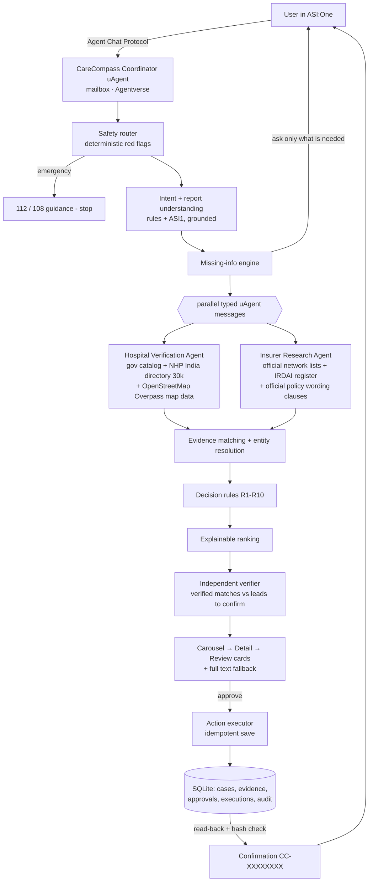

# CareCompass AI

**From Medical Concern to Coordinated Care.** One request gets you a smarter hospital choice, checked insurance information and a real action.


CareCompass is a multi-agent healthcare-navigation system built on Fetch.ai uAgents and the Agent Chat Protocol, and it runs entirely inside **ASI:One**. A user describes a health concern, a known condition or a medical report in one message. CareCompass checks it for emergencies, works out which hospital service is relevant, and sends **two specialist agents** to research hospitals and insurer networks. It then matches their evidence, detects contradictions, ranks options explainably and verifies every claim. Finally it shows an Interactive Card shortlist and, **only after the user approves**, saves the shortlist and its evidence. It reads the saved record back to verify it and returns a real reference ID.

> CareCompass is a navigation assistant. It does not diagnose, and it never says a treatment is "covered". Network listing, plan exclusions and cashless availability are tracked as separate, evidence-backed states.

---

## Why it matters

In India, a patient with an ACL tear, a kidney stone or just "knee pain for two weeks" has to work out several things alone:

- which specialty to approach,
- which hospitals in their city offer it,
- whether those hospitals appear in their insurer's network,
- whether their plan excludes the procedure.

This information is scattered across hospital sites, insurer PDFs and directories, and it often contradicts itself. CareCompass turns one message into an evidence-backed, explainable shortlist. When the evidence is missing or conflicting, it says so plainly.

## What makes it different

| | |
|---|---|
| **Minimal input** | One message usually starts the search. CareCompass asks only for what the next step strictly needs (typically just the city). Insurance is optional. |
| **Medical-context aware, not diagnostic** | It extracts facts from a report and keeps their status: *stated*, *hedged* ("possible…") or *ruled out* ("meniscus intact"). Each finding links to the exact sentence it came from. |
| **Real multi-agent research** | The Coordinator sends typed requests to a **Hospital Verification Agent** and an **Insurer Research Agent** in parallel, using real uAgent messaging with timeouts and bounded retries. |
| **Evidence-aware matching** | Every claim is an `Evidence` record with source URL, source type, excerpt and retrieval time. Entity resolution matches "ABJH" or "Aravali Bone and Joint Hosp." to the right hospital, but never merges different branches. |
| **Conflict detection** | If one insurer source lists a hospital and another de-lists it, the result is `SOURCES_CONFLICT` plus `NETWORK_UNCERTAIN`, and the user sees both sources. |
| **Explainable ranking** | The suitability score shows its per-dimension breakdown and is kept separate from evidence confidence. The weights are configurable product choices, not clinical quality. |
| **Independent verifier** | A deterministic verifier re-derives each claim. It rejects citations the research agents never returned, downgrades unsupported network claims, and removes "covered", "guaranteed" or "booked" language. |
| **Human-approved, verified action** | Review card → approval (hash of the exact payload) → a single-transaction save → read-back verification → confirmation ID. The save is idempotent, so a repeated approval never writes twice. |
| **Graceful failure** | An insurer outage gives "not checked", never "out of network". If the hospital agent is down, the user gets `retry`. If a DB write fails, the user gets a bounded retry and no false confirmation. |

## Architecture



The full design is in [docs/ARCHITECTURE.md](docs/ARCHITECTURE.md) and the state machine is in [docs/STATE_MACHINE.md](docs/STATE_MACHINE.md).

## Agents

| Agent | Role | Protocols | Address |
|---|---|---|---|
| **CareCompass AI** (Coordinator) | Public ASI:One agent. Handles conversation, safety, orchestration, cards, approval and action. | `AgentChatProtocol` 0.3.0 (manifest published), CareCompass research protocols (client) | `agent1qf4xxsxv47fa6ghqvv7x8s6lhqw66vp52zgldq8w0xyueyd5cnkavhkl4dm` * |
| **Hospital Verification Agent** | Independent hospital discovery and specialty/location evidence. | `CareCompassHospitalResearch` 0.1.0 | `agent1qdzx6pvjjdnp2mhg9039ddgv9x0lw8n38fhqdxkkz04k4p5sl80x5m7v4aj` * |
| **Insurer Research Agent** | Network listings, de-listings, plan exclusions and waiting periods, with sources. | `CareCompassInsurerResearch` 0.1.0 | `agent1qt6ha0v4ge4sd6fl9lsgple7ly0l9d35kfls5wzrs08kzu58tcpax5v0dd8` * |

\* These addresses come from the seeds in the maintainer's local `.env`. A new `--init-env` produces different addresses. Print yours with `python scripts/run_agents.py --addresses`. **Agentverse profile:** [CareCompass AI](https://agentverse.ai/agents/details/agent1qf4xxsxv47fa6ghqvv7x8s6lhqw66vp52zgldq8w0xyueyd5cnkavhkl4dm/profile). **Chat:** [Open in ASI:One](https://asi1.ai/ai/agent1qf4xxsxv47fa6ghqvv7x8s6lhqw66vp52zgldq8w0xyueyd5cnkavhkl4dm).

## Quick start

Requires Python 3.10+ (tested on 3.12).

```bash
git clone https://github.com/Mananfrfr/CareCompass_AI.git carecompass-ai && cd carecompass-ai
python -m venv .venv
# Windows: .venv\Scripts\activate      Linux/macOS: source .venv/bin/activate
pip install -r requirements.txt
python scripts/run_agents.py --init-env      # writes .env with fresh agent seeds (git-ignored)
# optional: add ASI1_API_KEY=... to .env (https://asi1.ai/dashboard/api-keys)
```

| Goal | Command |
|---|---|
| Run all tests (incl. the real 3-agent ACP test on ports 8000-8002, 8010) | `python -m pytest` |
| Live-data test (real OpenStreetMap) | `python -m pytest -m live` |
| Real ACP + multi-agent journey with JSON report | `python scripts/test_protocol.py` |
| Scripted conversations in the terminal | `python scripts/demo_scenarios.py` |
| Chat in the terminal | `python scripts/demo_scenarios.py --interactive` |
| Measure metrics | `python scripts/benchmark.py --runs 20` |
| **Start the agents for ASI:One** | `python scripts/run_agents.py` |
| Synthetic demo cities instead of live data | set `CARECOMPASS_DATA_MODE=fixture` in `.env` |
| Rebuild the India hospital directory | `python scripts/import_nhp_hospitals.py hospital_directory.csv` |

### Connect to Agentverse and ASI:One (manual, needs your account)

1. Run `python scripts/run_agents.py`. The coordinator log prints an **Agent inspector** link and `Manifest published successfully: AgentChatProtocol`.
2. Open the inspector link while signed in to [agentverse.ai](https://agentverse.ai), then click **Connect → Mailbox**. The log then stops showing `Agent mailbox not found`.
3. On the agent's Agentverse page, check the name, description, README (from [docs/AGENT_PROFILE.md](docs/AGENT_PROFILE.md)) and the *AgentChatProtocol* badge.
4. In [asi1.ai](https://asi1.ai), search for "CareCompass" or message the agent address directly, then run the demo in [docs/DEMO_SCRIPT.md](docs/DEMO_SCRIPT.md).
5. Share the chat to get a public ASI:One URL for the submission.

The detailed runbook is in [docs/AGENTVERSE_DEPLOYMENT.md](docs/AGENTVERSE_DEPLOYMENT.md). Keep the process running, because the local agents serve the mailbox. The Dockerfile runs the same three agents on any always-on host.

## Environment variables

See [.env.example](.env.example). The key ones:

- `ASI1_API_KEY`: optional. Without it, CareCompass falls back to its deterministic parser.
- `CARECOMPASS_DATA_MODE`: `live` (default, real data for every Indian city) or `fixture` (synthetic demo cities + real directory elsewhere).
- `*_SEED`: the agent identities. Keep them secret.
- `COORDINATOR_CONNECTIVITY`: `mailbox` or `local`.
- `DATABASE_URL`, `RESEARCH_TIMEOUT_S`, `RESEARCH_MAX_ATTEMPTS`, `ACTION_MAX_ATTEMPTS`, `HTTP_USER_AGENT`.

## Data modes

| Mode | Hospitals | Insurance | Use |
|---|---|---|---|
| `live` (default) | **Every Indian city**: National Health Portal hospital directory (~30,000 government-registered facilities, MoHFW / data.gov.in), state government catalogs, reviewed clinical profiles, and live **OpenStreetMap** map data via the Overpass API. | Real insurers are recognised from the **IRDAI product register** (600+ product identities); the user's plan is matched to its UIN and official policy wording, which is read to quote waiting-period / exclusion clauses for the procedure. Network status comes only from official lists imported by the operator ([format](data/insurer_networks/README.md)); otherwise CareCompass says "not checked" and links the insurer's official site. | Real-world use |
| `fixture` | 12 **fictional** hospitals for Jaipur, Delhi and Ajmer; the real national directory for every other city (never mixed in one result) | Fictional insurers *Demo Shield Insurance* and *Sample Care Health* use synthetic data; real insurer names use the real-insurer pipeline above | Reproducible demo of every path |

Synthetic data is labelled in every reply, card badge and saved record, and real hospitals are never labelled synthetic.

### Verified matches vs. leads to confirm

A hospital is a **verified match** only when a current official source (the hospital's own site or a reviewed clinical profile) confirms the service *and* any required capability (e.g. dialysis, ACL reconstruction). Most hospitals in India do not publish that in machine-readable form, so CareCompass also shows **leads to confirm**: real, government- or map-listed hospitals whose directory entry lists the specialty, whose name indicates it, or which are general / multi-speciality hospitals. Leads get a transparent **lead score** (service evidence, listed facilities, insurer listing, distance, contactability), a phone number, a Google Maps link and directions, and an explicit "call to confirm the department" label. They never receive a CareCompass tier or "high" confidence. If nothing is found inside the city, the search widens once to ~40 km and says so.

## Implementation status

### India-wide coverage upgrade (24 October 2026, evening)

- **No more empty answers for real cities.** The previous build only had evidence for a few demo hospitals, so "ACL tear in Mumbai" returned nothing. Discovery now covers ~30,000 registered facilities across India (703 districts/towns), plus live OpenStreetMap data, with conservative cross-source de-duplication.
- **Map replaced:** the fuzzy Nominatim text search (max 40 results, often missing major hospitals) is replaced by an Overpass radius query around the city centre; every option has a Google Maps link, directions and distance from the centre.
- **Real insurers (Star Health, HDFC ERGO, …):** IRDAI register identity, plan → UIN → official policy wording (live: clauses mentioning the procedure are quoted), official website link, and honest "network not checked" when no official list is imported.
- **Bug fixes:** an empty shortlist no longer swallows the next message as "Nothing was saved…"; real hospitals found in fixture mode are no longer labelled "synthetic"; `my plan is …` and policy UINs are understood without repeating the insurer; small towns (e.g. Pali, Bhilwara) are recognised from the directory.
- **Payment step:** RequestPayment metadata now matches Fetch's Stripe example (`ui_mode`, `checkout_session_id`, string values only, `service`); a checkout that Stripe confirms expired *and unpaid* can be re-issued instead of locking the user out forever; "buy/get report" phrasings are recognised.
- Fixed: the Docker image never copied `data/catalog`, so deployed agents had no government catalog or IRDAI register.
- Tests: 146 passing locally (payments suite and the new India-coverage suite included; real-uAgent e2e tests not run in this environment).

### Earlier additions (24 October 2026)

- Ask **care brief** after saving for a source-linked preparation checklist with hospital and insurer questions. This uses saved evidence, not a fresh verification or booking.
- Stale case/version approvals are rejected even after completion; an approval cannot silently change the selected hospital.
- Insurer imports reject invalid, future or older-than-30-day retrieval dates and empty/malformed lists.
- Optional **AgentPaymentProtocol** seller integration: **buy preparation report**. Stripe test mode only, disabled until seller configuration; no real payment or ASI:One checkout has been demonstrated. See [payments and proposed monetization](docs/PAYMENTS.md).
- Current live-data findings and unresolved postcode discrepancy: [live-data review](docs/LIVE_DATA_REVIEW.md). No permission-confirmed insurer dataset has been imported.
- Latest continuation state: [handoff](docs/HANDOFF.md). Older verification tables below describe earlier milestones.

Each status means only what it says.

| Capability | Implemented | Tested locally | Tested with live API | Tested inside ASI:One |
|---|---|---|---|---|
| ACP handler (ack, text, start-session, resources, metadata) | ✅ | ✅ real uAgents (`test_protocol.py`) | n/a | ✅ synthetic text/card journey |
| Manifest publication to Agentverse | ✅ | ✅ log: `Manifest published successfully` | ✅ | ❌ |
| Almanac registration | ✅ | ✅ log: `Registration on Almanac API successful` | ✅ | n/a |
| Agentverse mailbox | ✅ (`mailbox=True`) | ✅ | ✅ connected 2026-10-23 | ✅ synthetic journey |
| Coordinator ↔ Hospital/Insurer agents (typed messages) | ✅ | ✅ 3 processes, 12/12 checks | n/a | ✅ synthetic journey |
| Interactive Cards (carousel/detail/review) + selection parsing | ✅ per documented schema | ✅ schema + round-trip | n/a | ✅ carousel/detail/review and callbacks |
| Text fallback for every step | ✅ | ✅ | n/a | ❌ |
| ASI1 intent extraction + shortlist summary | Grounding + validation + fallback | Mocked client tests pass | Live structured extraction passed, 2026-10-24 | Runtime configured; initial card demo used rules |
| Safety routing, report parsing, question engine | ✅ | ✅ | n/a | ❌ |
| Live hospital discovery (OpenStreetMap) | ✅ | ✅ | ✅ `pytest -m live` | ❌ |
| Hospital website specialty verification | ✅ | ✅ (mock transport) | ⚠️ code path ran, but no top Jaipur candidate had a website tag | ❌ |
| Official insurer network list import | ✅ | ✅ | ❌ no official list imported yet (manual) | ❌ |
| PDF report via ResourceContent URL | ✅ (SSRF-guarded download + pypdf) | ✅ extraction | ❌ ASI:One attachment URL format not yet observed | ❌ |
| Image report OCR | ❌ not implemented (asks user to paste text) | — | — | — |
| Approval → idempotent save → read-back verify → ID | ✅ | ✅ incl. DB failure + duplicates | n/a | ✅ CC-9DVGJS5A; one record after repeated approval |
| External inquiry / booking | ❌ not implemented (see [LIMITATIONS](docs/LIMITATIONS.md)) | — | — | — |

## Latest verification (2026-10-23)

The earlier 23 October build passed **89 tests**, including a real three-agent ACP journey. Regression tests cover emergency interruption during approval, ambiguous consent, and specialty keyword false positives. The coordinator mailbox is connected on Agentverse. A synthetic ASI:One conversation completed the carousel, detail, review, approval and duplicate-approval flow. The saved reference `CC-9DVGJS5A` matched SQLite, with exactly one saved shortlist. ASI:One prefixes callbacks with the recipient mention; the transport now removes only its own exact address before parsing. Earlier measurements below describe the initial build.

## Measured results

Measured on 2026-10-23 with `scripts/benchmark.py` (fixture data, in-process) and `scripts/test_protocol.py` (real uAgents):

| Metric | Result |
|---|---|
| Automated tests | 66 passed (`pytest`), plus 1 live-data test passed (`pytest -m live`) |
| Workflow completion (100 journeys, 5 types) | 100% |
| Duplicate approvals creating a new side effect | 0 / 100 |
| Unsupported coverage/diagnosis claims in replies | 0 |
| Source-conflict detection (seeded conflict) | 20 / 20 |
| Follow-up questions | 0 for condition, report and outage paths; 1 (city) for symptoms-only |
| Turn latency, in-process | avg 19 ms, p95 29 ms |
| Real ACP: acknowledgements | 6 / 6 |
| Real ACP: end-to-end checks | 12 / 12. The first turn, including both agent round-trips, took 0.16 s. |

The full matrix of expected vs observed results for every test is in [docs/TEST_MATRIX.md](docs/TEST_MATRIX.md).

## Repository layout

```
app/agents/        coordinator (ACP), hospital_agent, insurer_agent, typed protocols
app/intelligence/  ASI1 client, intent + report parsing, safety router, question engine, explainer, attachments
app/research/      hospital & insurer sources (fixture/live), safe fetcher, entity resolution, research service
app/matching/      evidence engine, decision rules R1-R10, ranking, independent verifier
app/workflow/      state machine, orchestrator, approval hashing, action executor
app/ui/            card builders, card/selection parsing, text fallback
app/database/      SQLAlchemy models, repository (session-scoped access)
app/security/      SSRF validation, redaction/privacy
data/              fixtures (synthetic), synthetic reports, insurer network import folder
scripts/           run_agents, test_protocol, demo_scenarios, benchmark
docs/              architecture, state machine, compatibility, deployment, sources, security, tests, demo, submission
```

## Safety and privacy

- Emergency red flags are checked deterministically **before** any research. If one is found, CareCompass gives 112/108 guidance (or Tele-MANAS 14416) and stops comparing hospitals.
- Raw report text is never stored or logged. Logs record only message length and a hash. Identifiers are redacted before any ASI1 call.
- Records are scoped to a hash of the user's chat. `delete my data` erases them all.
- Outbound fetches are SSRF-guarded on every redirect hop, with scheme/port/IP checks, size caps and timeouts.
- Retrieved text is untrusted data. It never reaches a code path that makes decisions (see the prompt-injection test).

Details are in [docs/SECURITY_AND_PRIVACY.md](docs/SECURITY_AND_PRIVACY.md).

## Limitations and future scope

The honest list is in [docs/LIMITATIONS.md](docs/LIMITATIONS.md). Planned next steps:
- live appointment availability and user-approved booking with real partner APIs,
- authorised insurer inquiries,
- Indian-language support,
- travel-time ranking,
- verified cost estimates,
- plan-document extraction,
- Validate the optional Payment Protocol sandbox in a supported checkout UI before any production rollout.

## License

MIT. Synthetic data is fictional. OpenStreetMap data is © OpenStreetMap contributors under ODbL.

### Final verification, 24 October 2026

**121 automated tests passed**, including isolated real ACP subprocesses; **1 live OpenStreetMap test passed** separately. The coordinator publishes both AgentChatProtocol and AgentPaymentProtocol. Payment checkout is a disabled Stripe-test-only prototype, not a live paid service. New fixes validate checkout responses, fail closed on malformed settlement, and reconcile expired orders without automatically offering a second checkout. Free `care brief` uses the saved evidence.

[Submission pack](docs/SUBMISSION_READY.md) | [Captioned demo video](docs/demo/CareCompass-demo.mp4) | [Payment limitations](docs/PAYMENTS.md). The video is a 3:12 edited walkthrough of actual screenshots, not a continuous recording.
