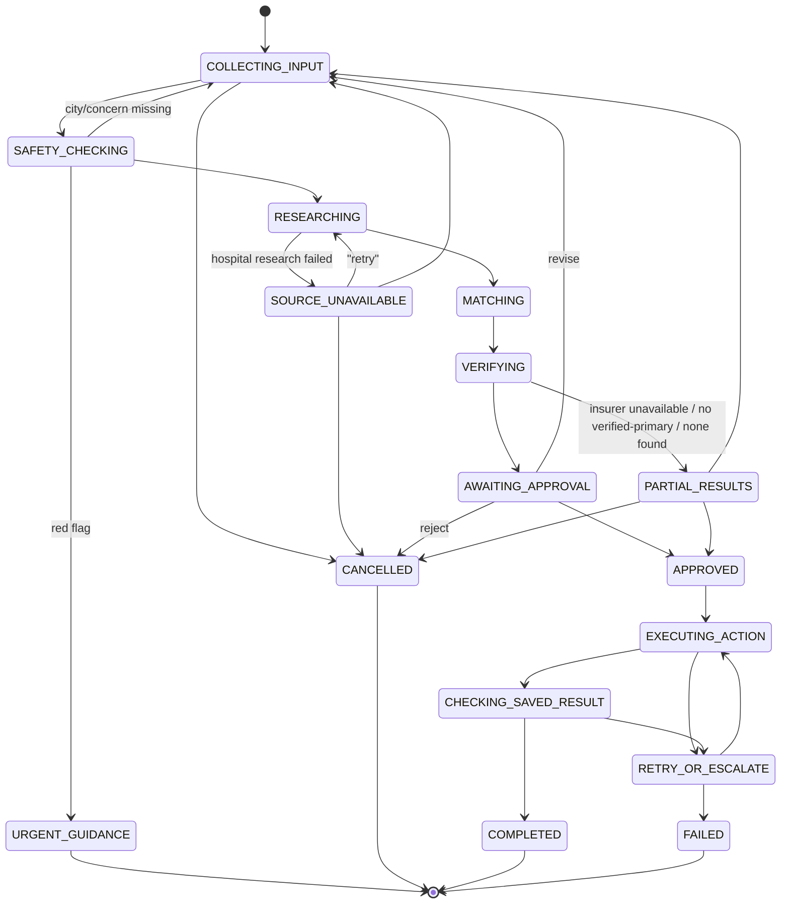

# Case state machine

Defined in `app/workflow/state_machine.py`. Any transition outside this table raises `InvalidTransition`, which is covered by tests. Every transition is written to `audit_events` with a trace ID.

## Situations handled

| Situation | Behaviour |
|---|---|
| Missing info | Stay in `COLLECTING_INPUT`. Ask only for concern and/or city, with insurer offered once as optional. The ask counters are persisted. |
| Agent timeout | `send_and_receive` timeout × `RESEARCH_MAX_ATTEMPTS` with backoff. Insurer failure → `PARTIAL_RESULTS`. Hospital failure → `SOURCE_UNAVAILABLE` (`retry` available). |
| Conflicting sources | Kept as `SOURCES_CONFLICT` + `NETWORK_UNCERTAIN`, and both sources are shown. |
| User rejects | An `approvals` row with `rejected` is written, then `CANCELLED`. Nothing is executed. The next message starts a new case that carries over earlier facts. |
| User changes choice | Any selection while the shortlist is shown just updates `selected_hospital_id`. Free text revises the request and re-researches. |
| Duplicate message | The unique `(direction, msg_id)` in `agent_messages` means it is ignored. |
| Repeated approval | The idempotency key finds the succeeded execution and returns the same confirmation ID. No new write happens. |
| Stale card | A `version` mismatch means the current review card is shown again and no action runs. |
| Message mid-pipeline | "Still working…" is returned and no second run starts. The per-session lock in the coordinator also prevents this. |
| DB error | Up to `ACTION_MAX_ATTEMPTS` attempts with backoff. If all fail → `FAILED`, and the user is told no confirmation was issued. The transaction rolls back, so nothing partial is saved. |
| Cancellation / reset | `new search` cancels any cancellable case. `delete my data` removes all of the session's records. |
